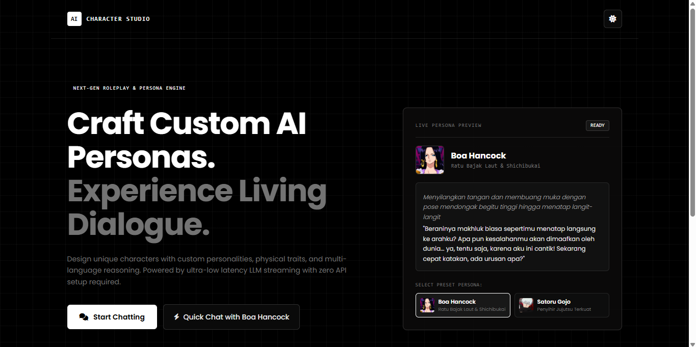

# AI Character Studio — Custom Persona Architect

**AI Character Studio** is a web application designed for crafting custom AI personas and engaging in expressive, real-time roleplay dialogue. Built with a clean monochrome architectural aesthetic, the platform allows users to shape character identities, switch between multiple LLM reasoning engines, and experience ultra-low latency token streaming directly in the browser.

**Live Demo:** [your-project-name.vercel.app](https://your-project-name.vercel.app)

---

## Project Purpose

This project was developed to explore and showcase modern frontend architecture combined with real-time generative AI integration:
- **Dynamic Prompt Engineering:** Transforming structured user inputs (appearance, personality traits, role relationships, and language preferences) into strict, context-aware system prompts.
- **Real-Time SSE Streaming:** Delivering natural, word-by-word AI dialogue with minimal latency using Server-Sent Events (SSE) and Vercel Edge Serverless Functions.
- **Zero-Friction User Experience:** Utilizing client-side state persistence (`localStorage`) and URL-encoded data sharing so users can create, manage, and share custom characters instantly without account registration.

---

## Key Features

- **Custom Persona Architect:** Define character names, roles, physical appearances, personalities, custom avatars, and opening greetings.
- **Multi-Slot Character Roster:** Create and switch between multiple custom personas seamlessly without losing individual chat histories.
- **Real-Time Streaming Dialogue:** Instant token-by-token responses powered by Groq Cloud LPU inference.
- **Multi-Model & Multi-Language Engine:** Switch between curated open-weight LLMs (`GPT OSS 120B`, `GPT OSS 20B`, `Qwen 3.8 27B`) and customize response languages on the fly.
- **Interactive Conversation Controls:** Edit previous user messages to branch storylines or regenerate AI responses at any point.
- **Sliding-Window Context Memory:** Automatically optimizes conversation history sent to the API to maintain long-term stability and prevent token overflow.
- **Portability & Sharing:** Share characters via encoded URL links, export/import `.json` persona cards, or download `.txt` chat transcripts.
- **Adaptive Monochrome UI:** Responsive mobile-first interface featuring instant Dark Mode and Light Mode switching.

---

## Application Preview

### Landing Page & Live Persona Showcase

---

## Tech Stack

| Category | Technology |
| :--- | :--- |
| **Frontend Framework** | React.js + TypeScript |
| **Build Tool** | Vite |
| **Styling & UI** | Tailwind CSS + FontAwesome Icons |
| **AI Inference Engine** | Groq Cloud API (Server-Sent Events Streaming) |
| **Serverless Backend** | Vercel Edge Functions (`/api/chat`) |
| **State & Storage** | React Hooks + Browser LocalStorage API |

---

## Author

Designed and developed by **Alip Saefulloh**